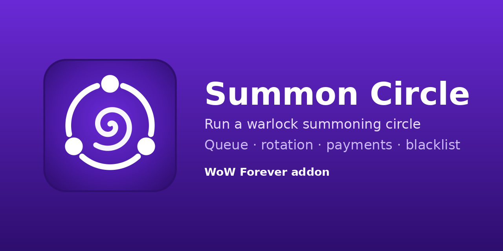

# Summon Circle

A WoW Forever addon for warlocks who run a summoning service together. One shared queue, fair turns, payment tracking and a shared blacklist, so the whole circle can focus on clicking portals. Every summoner needs the addon; customers don't.

## Features

### For everyone
- **One shared queue:** customers whisper `inv`, `invite`, `summon` or `+` to any summoner. They're invited automatically, told their place in line, and every summoner sees the same queue.
- **Fair rotation:** summoners take turns in order. Anyone out of soul shards or AFK is skipped, and whoever summons out of turn simply moves the turn along.
- **A "what to do now" box:** one big button walks you through each customer: **Summon → Trade → Kick**. No guessing whose turn it is or what's next.
- **Portal alerts:** when another summoner opens a portal, you get an on-screen warning and a sound telling you to click it.
- **Payment tracking:** trades are detected automatically. Earnings are tracked per summoner, along with gold per hour.
- **Non-payment handling:** customers who don't pay within 3 minutes are flagged. You can kick them or kick and blacklist them, and anyone who leaves without paying can be blacklisted in one click.
- **Shared blacklist:** blacklisted players aren't invited when they whisper. Blacklists merge between summoners whenever they group up.

### For the group leader
- **Open for business / Close shop:** the addon does nothing until you open. It never interferes with questing groups or dungeons, and it closes itself when you log out or leave the group.
- **Pick your summoners:** choose which warlocks in the group are summoning. They get assist automatically.
- **Advertise in one click:** posts your ad to every chat channel you choose, with your city, price and queue length filled in.
- **Shared price:** set it once and every summoner's replies and ads use it.

### Under the hood
- **Stays in sync even when the group changes:** if the leader leaves, another summoner takes over the queue without losing anything.
- **Private:** queue and blacklist data is only shared with the group's summoners, never with customers.
- **Raid only when needed:** the group becomes a raid only once a second summoner joins or the party is nearly full.

## Install
**WowUp:** Get Addons → Install from URL → paste `https://github.com/edgaming/SummonCircle`. Pick **WoW Forever** at the top first.

**Manually:** download the zip from the latest [release](https://github.com/edgaming/SummonCircle/releases) and unzip it into your Forever `Interface/AddOns/` folder.

## Quick start
Type `/sc` to open the window.

**Leader**
1. Invite the other summoners, click the gear next to **Summoners**, and tick them.
2. Click the gear next to **Advertise** to set your price, channels and message.
3. Click **Open for business**. The bar turns green.
4. Click **Advertise** whenever you want to post. Click **Close shop** when you're done.

**Summoners**
Read the purple box and press the big button under it.

## Commands
`/sc` (or `/summoncircle`) toggles the window. `/sc help` lists the rest: whisper triggers, the thanks message, blacklist management (`/sc bl add First Last [reason]`, `/sc bl del First Last`, `/sc bl list`), earnings reset and lifetime stats.

## Known limitations
- Customers inside a dungeon or battleground aren't flagged yet. A summon to them just times out and they go back into the queue.

## Development
- **Tests:** `pip install lupa`, then `python tests/run.py`. This loads the addon in a fake WoW environment (`tests/wowmock.lua`) and runs every `tests/t_*.lua` scenario. The tests also run on GitHub for every push.
- **Releasing:** change the number in `VERSION` (e.g. `0.6.3`) and push to `main`. GitHub Actions runs the tests, creates the tag, packages the addon with the BigWigs packager, and publishes a release. WowUp offers the update to anyone who installed from the repo URL.
- The version shown in game comes from the tag. The `@project-version@` placeholder in the `.toc` is filled in when the release is packaged.
- **Art:** `art/icon.svg` is the icon source. `Media/icon.tga` (64×64) is the in-game icon, set via `## IconTexture` in the `.toc`. `art/social-preview.png` is the 1280×640 banner used for the GitHub social preview, which WowUp shows as the addon's image.
